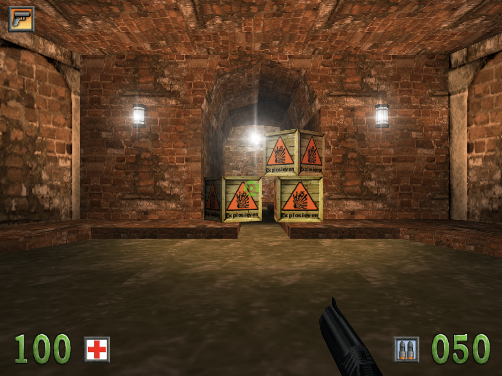
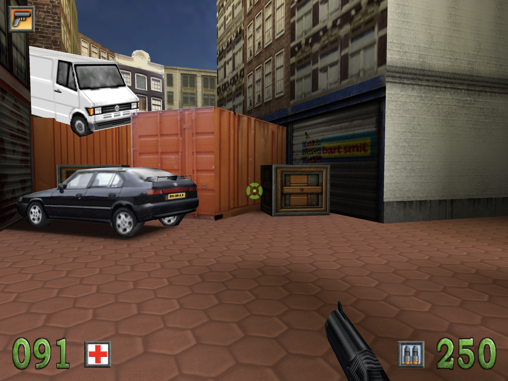

# Amsterdoom — Nintendo Switch port (homebrew)

Play **Amsterdoom** (the Dutch first-person shooter from 2000, set in Amsterdam) on a Nintendo
Switch, handheld or docked.

<p>
  
  
</p>

This repository contains only the **port**: the game program rebuilt as a Switch homebrew program
(`Amsterdoom.nro`, OpenGL ES through Mesa). It contains **none of the game's files** (levels,
graphics, sounds, music, the intro film). To play, you need **your own copy of Amsterdoom**: the
original CD, or a folder where the game is installed. A Switch cannot read CDs, so you first copy
the game to the Switch's SD card on a computer.

## Requirements

- A Nintendo Switch that runs homebrew: custom firmware (**Atmosphère**) with the **Homebrew
  Menu** (hbmenu). This port is not an official Nintendo product and cannot be installed from the
  eShop.
- An SD card with about **450 MB** free while reading in (your copy of the game, plus the
  program's own copy of about 220 MB; afterwards you can delete your copy).
- A computer with an SD card reader (or another way to put files on the card), and your
  Amsterdoom CD or installed game.

## Getting it

- **As a download**: click **Amsterdoom.nro** on this page, then the download button
  (**Download raw file**).
- **With git**:

    ```sh
    git clone https://github.com/DavidStolk/amsterdoom-nintendo-switch-port.git
    ```

## Playing

1. **Put the files on the SD card.** Put the Switch's SD card in the computer, then:
    - copy `Amsterdoom.nro` to the card's `switch` folder (`/switch/Amsterdoom.nro`);
    - copy your Amsterdoom CD to the card: the whole CD into a new folder, for example
      `/Amsterdoom`. The folder of the installed game (with `Adamwin.ini`, `AdamWin.exe` and the
      `Levels` folder) works too. If you copy only the CD's `Target Files` folder, copy
      `Intro.mpg` from the CD next to it, or the game starts without its intro film.

    Put the card back in the Switch and turn it on.
2. **Start the Homebrew Menu with full memory**: hold **R** while starting any game or app from
   the HOME menu, and keep holding until the Homebrew Menu appears. (Started from the album, the
   game gets too little memory to load a level, and it says so.) Choose **Amsterdoom**. A start
   screen opens.
3. **Read in the game**: choose **Kies de map op de sd-kaart… / Choose the folder on the SD
   card…** and, in the screen's own folder list (controller or touchscreen), go to your copy and
   choose **Kies deze map / Choose this folder**. The program finds the game in the chosen folder
   by itself (it looks for `Adamwin.ini`, which on the CD is in `Target Files`), so choosing the
   folder of the whole CD copy is fine; the list says "Amsterdoom found in this folder" when it
   is in the right place.

    The files are copied to `/switch/Amsterdoom/GameData` on the SD card. **They are not uploaded
    or sent anywhere.** Reading in takes a minute or two (around 220 MB). After that, the copy you
    put on the card in step 1 is no longer needed; you can delete it to free the space.
4. Press **A** (or **+**, or tap the screen) to play.

On later starts the start screen shows **Druk op A om te spelen** (press A to play) straight
away. Saved players and a log (`log.txt`) are kept in `/switch/Amsterdoom/` on the SD card. To
remove the game files, use the link on the start screen ("remove the game files from this
Switch"); your saved players stay. **−** on the start screen leaves the program.

The game is in Dutch. It shows the game's 4:3 picture as large as the screen allows, with black
bars at the sides (1280×720 in the hand, 1920×1080 docked). In the menu, **Opties → Weergave**
lowers the 3D resolution if it runs too slowly.

## Controls

Changeable in the menu under **Opties → Besturing** (kept per player, with the Switch's own button
names). Joy-Cons, the Pro Controller and compatible controllers work.

| Action                 | Switch                     |
| ---------------------- | -------------------------- |
| Walk / step            | left stick                 |
| Turn / look            | right stick                |
| Fire                   | ZR                         |
| Walk slowly            | hold ZL                    |
| Jump                   | A                          |
| Previous / next weapon | L / R                      |
| Weapon 1–4             | D-pad ↑ → ↓ ←              |
| Weapon 5               | X                          |
| Centre the view        | Y or click the right stick |
| Pause                  | +                          |
| Back to the menu       | −                          |

In the menus: D-pad or left stick to move, **A** to press, **B** to go back. To type your name,
press **A** on the name field (or tap it) and the Switch's keyboard opens.

The touchscreen works in all menus, next to the controller: in the main menus as a mouse (tap,
drag a slider, double tap a list row); in the in-game menu a tap on a line chooses it (on a
slider or `[ value ]`: left of the knob / middle for less, right for more) and a tap on the top or
bottom bar goes back; a tap ends the pause. In the game itself touch does nothing.

A USB keyboard and mouse (through the dock) work too, with the game's original keys.

## Troubleshooting

- **"Amsterdoom needs the full memory of the Switch"**: it was started from the album. Start the
  Homebrew Menu by holding **R** while starting a game (see [Playing](#playing)).
- **"No Amsterdoom found in this folder"**: choose the CD copy itself, its `Target Files` folder,
  or the folder of the installed game. The game folder needs `Adamwin.ini`, `AdamWin.exe`,
  `AdamMenu.exe` and the `Levels` folder.
- **"Reading failed"**: too little free space on the SD card (about 220 MB is needed next to your
  copy), or a damaged file on the card. Free some space and try again.
- **The intro film does not play**: `Intro.mpg` was not copied. Copy it from the CD next to the
  `Target Files` folder of your copy, and read in the game again (first use the link to remove
  the game files).
- **The game stops or shows a black screen**: it writes what went wrong to
  `/switch/Amsterdoom/log.txt` on the SD card.
- **The in-game texts look different from the original**: the original game uses Windows' Times
  New Roman for them (the menu's own font is used without it). If you have your own copy of that
  font (`times.ttf`), put it in `/switch/Amsterdoom/fonts/` on the SD card.

## Legal

Amsterdoom, its name, levels, graphics, sounds, music and film are the property of their rights
holders. This repository contains none of them; you need your own copy of the game to play.
Nintendo Switch is a trademark of Nintendo; this is an unofficial homebrew program, not made or
approved by Nintendo.

The engine is **Genesis3D 1.0** (Genesis3D Public License, see `LICENSE-Genesis3D.txt`). Also
used: **SDL2** (zlib license), **pl_mpeg** (MIT license), **stb_truetype** (MIT license or public
domain), **libnx** (ISC license), **Mesa** and **libdrm_nouveau** (MIT license) and devkitA64's
**newlib** C library (BSD-style licenses). Their license texts are in `THIRD-PARTY-LICENSES.txt`.
The start screen uses the Switch's own system font; nothing of it is in this repository.
